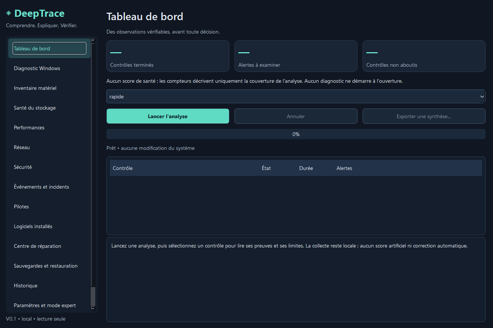

# DeepTrace

**Comprendre → Expliquer → Agir → Vérifier**

DeepTrace est une application desktop Windows de diagnostic local. Elle rassemble des
observations vérifiables, les explique en français et distingue les faits des hypothèses.
Elle ne promet pas de gain de performances et ne produit aucun score de santé artificiel.

**Version 0.1.1 — exécutable portable Windows, diagnostics en lecture seule.**
Les réparations sont simulées. Les sauvegardes et restaurations sont documentées, mais
ne sont pas encore exécutables. Aucun composant d'intelligence artificielle ni accès
à une API externe n'est nécessaire au fonctionnement.

Télécharger **[DeepTrace.exe dans la dernière Release](https://github.com/Seiha1337/DeepTrace/releases/latest)**,
puis double-cliquer : aucun Python à installer, aucune élévation administrateur.
Le binaire est portable, x64, non signé Authenticode. Les données restent dans votre profil
Windows. Voir [le bilan de validation](docs/STATUS.md) pour les contrôles effectivement réalisés.

## Mises à jour

Au premier lancement, DeepTrace propose de vérifier les versions GitHub au démarrage et
d'installer automatiquement les nouvelles versions stables. Après accord, cette opération
se déroule en arrière-plan, attend la fin des analyses puis redémarre l'application.
Les options restent désactivables dans Paramètres ; le diagnostic fonctionne hors connexion.

Seuls les fichiers `DeepTrace.exe` des Releases officielles sont acceptés. Taille, emplacement
HTTPS et SHA-256 sont vérifiés. L'ancienne version est conservée à côté de l'exécutable,
et restaurée si le remplacement ou le lancement échoue. Un crash ultérieur de la nouvelle
version n'est pas détecté automatiquement. La mise à jour nécessite un dossier d'exécutable
accessible en écriture, sans demander de droits administrateur.

Les commits ordinaires ne sont pas distribués directement : une version `vX.Y.Z` déclenche
les tests, la construction Windows puis la publication du binaire dans une Release.



Capture de l'application réelle, sans analyse démarrée et sans données personnelles.

## Fonctionnalités disponibles

| Domaine | Contrôles réellement implémentés |
|---|---|
| Matériel | CPU, barrettes RAM, GPU, carte mère et BIOS annoncés par Windows |
| Windows | Version/build, architecture, dernier démarrage, mémoire disponible, services |
| Stockage | Espace libre des volumes fixes, état résumé des disques physiques |
| Performances | Charge CPU instantanée, cinq processus les plus consommateurs de mémoire résidente |
| Sécurité | État Defender et activation des profils du pare-feu |
| Réseau | État, description et vitesse annoncée des adaptateurs, sans requête réseau |
| Incidents | Au plus 50 erreurs/critiques système des sept derniers jours, sans message libre |
| Pilotes | Au plus 300 pilotes PnP, version et signature déclarée |
| Logiciels | Au plus 500 entrées de désinstallation HKLM/HKCU, sans `Win32_Product` |
| Explications | Faits, preuves, interprétation, hypothèse, gravité, confiance et vérifications |
| Historique | Analyses SQLite, chargement, suppression explicite et comparaison de deux analyses |
| Rapports | Synthèse HTML ou JSON filtrée ; aucune donnée brute exportée |
| Interventions | Prévisualisation et journalisation d'un plan de revue de l'espace disque |

Les domaines sans donnée sont indiqués comme non exécutés ou indisponibles. Une absence
d'alerte signifie seulement qu'aucune des règles implémentées ne s'est déclenchée.

## Prérequis et installation

- Cible : Windows 11 x64 et Windows PowerShell 5.1 à son emplacement système.
- Python **3.11 ou supérieur, version stable recommandée**, x64, avec `venv` et `pip`.
- Environ 250 Mo pour l'environnement Qt Essentials et les outils de développement.
- Connexion nécessaire au téléchargement initial des dépendances, puis fonctionnement local.
- Aucun compte administrateur nécessaire pour démarrer ; certains fournisseurs Windows
  peuvent refuser un contrôle. DeepTrace ne déclenche aucune élévation automatique.

Dans PowerShell, à la racine du dépôt :

```powershell
python -m venv .venv
.\.venv\Scripts\python.exe -m pip install -r requirements-dev.lock
.\.venv\Scripts\python.exe -m pip install --no-deps --no-build-isolation -e .
.\.venv\Scripts\python.exe -m deeptrace
```

Le paquet utilise **PySide6-Essentials**, sans Qt WebEngine, serveur ou dépendance IA.
Une installation plus souple est possible avec `pip install -e ".[dev]"` ; le fichier
verrouillé correspond à l'environnement de validation décrit dans `docs/TESTING.md`.
La distribution portable `DeepTrace.exe` embarque Python stable et Qt Essentials.
Un installateur Windows signé reste à développer.

## Utilisation

1. Ouvrir le tableau de bord : aucune analyse ne démarre automatiquement.
2. Choisir le niveau, puis **Lancer l'analyse**.
3. Sélectionner un contrôle pour lire observations, preuves et limites.
4. Activer le mode expert dans **Paramètres et mode expert** pour afficher le script exact,
   sa source, les prérequis et le code de retour.
5. Exporter une synthèse filtrée si nécessaire. Les observations détaillées restent locales.

L'interface sombre comporte des vues Matériel, Windows, Stockage, Performances, Réseau,
Sécurité, Incidents, Pilotes et Logiciels, ainsi que les centres de réparation, de protection,
l'historique et les paramètres. Les analyses s'exécutent sur un thread de travail.
L'annulation attend la fin ou le timeout du contrôle courant, puis marque les autres annulés.

### Niveaux d'analyse

- **Rapide** : 8 collecteurs légers, généralement quelques dizaines de secondes.
- **Approfondie** : 12 collecteurs, ajoutant événements, pilotes, logiciels et services.
  Un avertissement précède le démarrage dans l'interface ; plusieurs minutes sont possibles.
- **Ciblée** : sous-ensemble prédéfini pour ralentissements, BSOD/freeze, crash de jeu,
  panne réseau ou démarrage difficile. Le texte du symptôme ne devient jamais une commande.

Les délais sont configurables de 1 à 120 secondes, plafonnés par le collecteur (25 ou 40 s).
Ce sont des requêtes ponctuelles, sans benchmark ni stress test.

### Ligne de commande

```powershell
# Les résultats et le journal restent dans un dossier local explicitement choisi.
.\.venv\Scripts\python.exe -m deeptrace --scan rapide --data-dir local --output local\rapport.html
.\.venv\Scripts\python.exe -m deeptrace --scan ciblée --symptom "Panne réseau" --data-dir local
```

`--no-history` empêche l'enregistrement de l'analyse (le journal technique reste actif).
`--timeout 15` change le plafond par contrôle. L'écrasement d'un export existant exige
`--overwrite`. Code de sortie : `0` si tous les collecteurs sont terminés, `2` si la
couverture est incomplète. Une alerte n'est pas un échec du programme.

## Méthode de diagnostic

Cinq règles explicites : espace libre **< 10 %**, mémoire disponible **< 10 %**,
état disque déclaré `Warning`/`Unhealthy`, profil de pare-feu désactivé et protection
temps réel Defender inactive. Les deux seuils sont des repères de triage documentés,
pas des seuils universels de panne. Les mesures nulles ou incohérentes ne déclenchent
pas ces règles. Un événement Kernel-Power 41 n'entraîne aucune conclusion matérielle.

Les alertes présentent l'effet possible, les vérifications complémentaires, les risques,
la protection nécessaire, les limites de retour arrière et la vérification après intervention.
Les données manquantes ne sont jamais remplacées par des valeurs estimées.

## Sauvegardes, restauration et interventions

Le centre de protection distingue image système, point de restauration, sauvegarde de
fichiers, sauvegarde de configuration et journal. **Il informe uniquement en V0.1.**
Aucune image, aucun point de restauration et aucune copie de fichiers ne sont créés.
Un point de restauration ne remplace ni une image ni une sauvegarde de fichiers.

Le catalogue d'interventions contient un seul plan simulé : préparer une revue de
l'espace disque. Il ne choisit ni ne supprime de fichiers. Une simulation est journalisée
comme telle et ne constitue jamais une réparation ou une protection vérifiée.
Les restaurations futures exigeront une confirmation explicite.

## Confidentialité et sécurité

- Aucune télémétrie et aucun secret collecté. Après accord, les mises à jour contactent
  GitHub en HTTPS ; aucun diagnostic n'est envoyé. GitHub reçoit les métadonnées ordinaires
  d'une requête réseau (dont adresse IP et version applicative dans le User-Agent).
- Pas de mots de passe, tokens, cookies, numéros de série, IP/MAC, arguments de processus
  ou messages libres d'événements dans les collecteurs.
- Les noms de composants, processus, logiciels et services restent dans l'historique local.
- Données par défaut : `%LOCALAPPDATA%\DeepTrace`. Historique SQLite non chiffré par
  l'application ; protéger le compte Windows et le support. Le dossier est personnalisable.
- Journaux tournants limités à environ 768 Ko ; seulement identifiant du collecteur,
  statut, durée et horodatage. Pas d'exception Windows brute enregistrée.
- Synthèse exportée : couverture, nombres d'observations, identifiants des règles et limites.
  Les dates d'analyse, identifiants d'analyse et preuves brutes en sont exclus.
- Scripts PowerShell fixes livrés avec le paquet : pas de shell libre, de commande issue
  d'un texte utilisateur ni de désactivation de la politique d'exécution.
- Aucun changement à Defender, BitLocker, pare-feu, DNS, Tailscale, AdGuard ou virtualisation.

La suppression d'une analyse est disponible dans l'historique ; elle ne garantit pas
l'effacement forensique sur SSD ou dans des sauvegardes externes. Les journaux et simulations
sont bornés à l'affichage mais n'ont pas encore de purge automatique globale.
Ne jamais joindre de base locale ou de dump à une issue.

## Architecture et développement

`catalog` décrit les collecteurs ; `runner` exécute les scripts fixes ; `rules` interprète
les mesures ; `engine` orchestre ; `storage` conserve les analyses ; `report` filtre
les exports ; `interventions` ne simule que des plans ; `ui` présente ces données.
SQLite et le moteur fonctionnent indépendamment de Qt. Aucune opération privilégiée
réelle n'est implémentée dans cette version.

```powershell
.\.venv\Scripts\python.exe -m pytest -q
.\.venv\Scripts\python.exe -m ruff check src tests tools
.\.venv\Scripts\python.exe -m ruff format --check src tests tools
.\.venv\Scripts\python.exe tools\check_repository.py
.\.venv\Scripts\python.exe -m build --no-isolation
```

La CI teste Windows et Linux ; Linux vérifie les composants portables et l'interface
simulée, sans constituer un support des diagnostics Linux. Aucun test automatique ne
répare Windows. Les règles et les tests doivent évoluer ensemble.
Branche principale : `master` ; branches de travail `dev/...` ou `feat/...`.
Versionnement SemVer et changements décrits dans [CHANGELOG.md](CHANGELOG.md).

## Limitations et dépannage

- Les capteurs thermiques, SMART/NVMe détaillés, GPU temps réel, mesures temporelles,
  SFC/DISM, tâches planifiées, démarrage automatique, mises à jour, BitLocker et CVE
  ne sont pas implémentés. Les investigations gaming utilisent les observations générales.
- Inventaires plafonnés ; absence d'un élément dans une liste n'établit pas son absence du PC.
- Un refus d'accès peut refléter une stratégie d'entreprise. Ne pas contourner les protections.
- **Indisponible** : fournisseur absent, accès refusé, plateforme non prise en charge ou
  aucune donnée. **Erreur** : requête ou réponse invalide. **Délai dépassé** : processus arrêté,
  résultat ignoré. Les autres collecteurs continuent.
- Un contrôle peut échouer dans un bac à sable même s'il fonctionne sous le compte Windows.
- Si Qt ne démarre pas, vérifier Python x64 et l'installation d'Essentials dans le bon `venv`.
- Si l'historique n'est pas accessible, choisir un dossier utilisateur avec `--data-dir`.
- Installation VM, accessibilité assistée, packaging Windows et restauration réelle restent
  à qualifier avant toute annonce de stabilité ou de disponibilité générale.

## Documentation et roadmap

- [Architecture](docs/ARCHITECTURE.md) et [diagnostics](docs/DIAGNOSTICS.md)
- [Sécurité](docs/SECURITY.md) et [protection/récupération](docs/BACKUP_RECOVERY.md)
- [Développement](docs/DEVELOPMENT.md) et [tests](docs/TESTING.md)
- [Roadmap](docs/ROADMAP.md) et [contributions](CONTRIBUTING.md)

V0.2 : approfondir les diagnostics ; V0.3 : sauvegardes vérifiées ; V0.4 : interventions
contrôlées ; V0.5 : surveillance ; V1.0 : stabilisation et installation Windows.
L'historique simple est déjà livré en V0.1 pour assurer la traçabilité initiale.
Pas d'intégration IA avant la consolidation des fondations.

Le code est public ; aucune licence de redistribution du code propre à DeepTrace n'est
accordée à ce stade. Les composants embarqués conservent leurs licences respectives :
voir [les notices tierces](docs/THIRD_PARTY.md).
