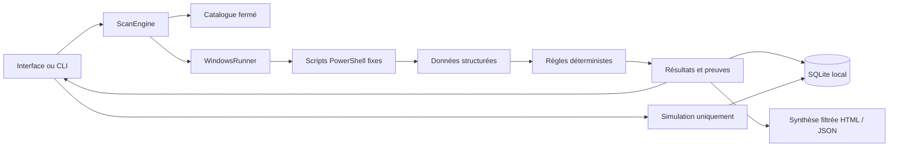

# Architecture

## Décisions initiales

- Python 3.11+, bibliothèque standard pour le moteur, SQLite pour les données locales.
- PySide6-Essentials / Qt Widgets pour une application native sans moteur web.
- PowerShell système 5.1, scripts versionnés et fixes ; aucun helper élevé en V0.1.
- Collecte séquentielle bornée : réduit la concurrence WMI et simplifie l'annulation.
- Un `QThread` de travail émet des signaux ; seuls les slots UI modifient les widgets.
- Les connexions SQLite sont courtes et créées dans le thread appelant.
- Rapport public par liste blanche plutôt que masquage de texte arbitraire.

## Flux

## Contrats

`CollectorSpec` expose objectif, champs, source, prérequis, privilèges, impact, plafond
et limitations. `CollectorResult` conserve statut, durée, date, données, alertes, erreur
sanitisée et code de retour. Les temps sont UTC ISO 8601 ; les volumes sont en octets,
la mémoire Windows en Kio, la charge CPU en pourcentage, les vitesses RAM en MHz déclarés.

Le runner n'accepte qu'un identifiant du catalogue et un délai borné. Son JSON contient
une liste `items` avec champs autorisés et valeurs scalaires ; réponse incohérente rejetée.
Les scripts n'engendrent pas d'autres processus. `subprocess.run` arrête et attend
PowerShell lors d'un timeout. Aucun résultat partiel n'est interprété.

## États

Collecteur : en attente (non encore présent) → terminé, indisponible, erreur ou délai
dépassé. Après demande d'annulation, le contrôle courant se termine ou expire ; les suivants
sont marqués annulés. La progression compte les étapes traitées et non les succès.
Une analyse complète peut avoir une couverture incomplète.
Intervention V0.1 : plan → simulée ; aucun état « corrigé » n'existe.

## Persistance et limites

Schéma SQLite version 1 : tables `scans` (JSON de l'analyse) et `simulations` (plan et état).
L'interface affiche au plus 200 analyses et 100 simulations récentes ; pas de purge implicite.
La comparaison ignore l'ordre des lignes, compare les données et les statuts, signale
les différences de couverture et n'attribue aucune causalité.
Les paramètres ne persistent pas encore entre sessions.

Un futur helper privilégié nécessitera une ADR séparée : authentification IPC, catalogue
fermé, validation des ressources, autorisations spécifiques, protection et vérification.
